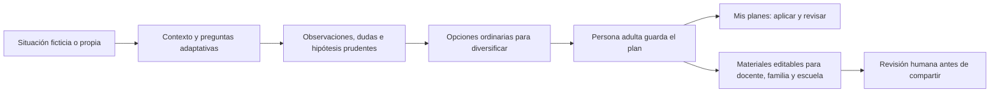

# SendIA

Prototipo educativo para que familias y profesionales de la educación ordenen observaciones, exploren posibilidades y acuerden pasos pequeños y revisables. No diagnostica ni atribuye conductas automáticamente a las altas capacidades.

## Desarrollo

Requiere Node.js 20.9 o posterior para la aplicación. Las pruebas y CI usan Node.js 22.

```bash
npm ci
npm run dev
```

## Módulos

- `/`: página pública de bienvenida.
- `/espacio`: inicio de demostración con datos ficticios.
- `/comprender`: situación propia o ejemplo ficticio de Alex; ambos recorren las mismas preguntas, propuesta y guardado explícito del plan.
- `/comprender?modo=demo`: recorrido preparado, sin Gemini en vivo y sin guardar plan; está identificado como simulación.
- `/planes/plan-aula`: revisión y seguimiento de propuestas aprobadas.
- `/beta/docentes/acceso` y `/beta/docentes/casos`: área de demostración docente separada, con doce casos ficticios. Las credenciales visibles en la pantalla son solo una simulación de acceso; no constituyen autenticación ni protegen datos reales.
- `/colaboracion`: preparación local de acuerdos entre estudiante, familia y escuela. Guarda perspectivas, un paso común, responsable e indicador en el navegador actual; permite preparar un resumen para compartir manualmente desde el dispositivo. Aún no sincroniza entre cuentas ni dispositivos.
- `/impacto`: cuestionario exploratorio de pilotaje, datos locales y exportaciones CSV.
- La interfaz usa español latinoamericano neutro (`es-419`); textos, glosario, países y formatos de fecha están centralizados en `src/lib/i18n/es-419.ts`. La estructura admite sumar diccionarios regionales sin cambiar el idioma actual.

## Arquitectura y recorrido

Next.js App Router organiza las páginas y rutas API. Los componentes de interfaz viven en `src/components`; esquemas, planes locales, privacidad y textos regionales en `src/lib`. No se agrega una base de datos: los planes aprobados y las respuestas del pilotaje quedan en el almacenamiento local del navegador.



El ejemplo de Alex y los casos docentes usan la misma interfaz de comprensión. Todo lo ficticio se marca como demostración. Para las salidas de docente, familia o escuela, el borrador se genera desde un plan aprobado y la persona confirma el envío de esos campos a Gemini.

## IA generativa

Copia `.env.example` a `.env.local` y define `GEMINI_API_KEY` en el servidor. Puedes configurar `GEMINI_MODEL`; el valor por defecto es `gemini-3.8-flash`. Verifica el identificador y el acceso de tu clave en la [lista oficial de modelos de Gemini](https://ai.google.dev/gemini-api/docs/models) o en Google AI Studio. Si el proveedor responde 404, SendIA indica el modelo que debe revisarse. No expongas la clave con el prefijo `NEXT_PUBLIC_`.

En `/comprender`, la persona adulta describe una situación, responde preguntas adaptativas y revisa una orientación estructurada. La propuesta distingue hechos, interpretaciones e información pendiente; propone hipótesis prudentes y diversificación según los principios del DUA. La persona adulta guarda explícitamente cualquier plan en el almacenamiento local del navegador. El servidor no guarda el texto, pero este sí se transmite al proveedor de IA tras el consentimiento. La generación usa límites de salida distintos por acción y reintenta una vez las respuestas incompletas o que no cumplen el esquema.

### Ejecutar la evaluación reproducible

Inicia la aplicación con Gemini configurado (`GEMINI_API_KEY` solo en el servidor) en una terminal y, en otra, ejecuta:

```bash
npm run eval:gemini -- --output=artifacts/gemini-evaluation-run-01.json
```

El script envía once casos ficticios al endpoint local por defecto (`http://localhost:3000`), incluido uno sin meta explícita para comprobar que se pida aclararla antes de adaptar. Para usar otra instancia, define `SENDIA_BASE_URL`. El archivo de resultados queda ignorado por Git; contiene las respuestas generadas para esos casos ficticios y señales automáticas, no puntuaciones de expertos. La revisión profesional se registra por separado con [la rúbrica de evaluación](docs/EVALUACION-IA.md). No es una prueba offline ni se debe ejecutar con datos reales.

La ejecución real del 12 de octubre de 2026 recibió 10/10 respuestas con esquema válido. El registro caso por caso y sus límites están en [resultados de la ejecución](docs/EVALUACION-IA-RESULTADOS.md): las dos revisiones profesionales todavía están pendientes; no se presenta una puntuación de calidad.

Las [simulaciones internas](docs/RESULTADOS-SIMULACIONES.md) cubren cinco recorridos cognitivos y cinco fixtures pedagógicos. No son pruebas con participantes, respuestas reales de Gemini ni evaluación de expertos.

La ruta aplica límites de tamaño y frecuencia. `SENDIA_MAX_AI_REQUESTS_PER_HOUR` configura el máximo global por hora (120 por defecto). Los contadores de solicitudes son en memoria: para producción con varias instancias se necesita un almacén externo, como Redis/Upstash, y autenticación. No se implementan aquí.

## Privacidad y uso responsable

El filtro de datos identificativos es heurístico. Detecta algunos correos, teléfonos, documentos de identidad, instituciones educativas y nombres compuestos, pero no detecta nombres de pila aislados ni todos los datos identificativos. No anonimiza el texto; si detecta un posible identificador, bloquea el envío. Las demostraciones usan exclusivamente situaciones ficticias.

No uses SendIA con datos reales de menores hasta contar con una base legal, un contrato de encargado de tratamiento y una evaluación de impacto en protección de datos. No es un producto clínico ni sustituye al equipo de orientación. Las respuestas generadas requieren revisión humana.

La página `/datos` resume qué se envía y permite borrar los datos con prefijo `sendia-` o `miradas-` del almacenamiento local y de sesión del navegador actual. La señal de nombres propios es heurística y revisable; no garantiza anonimización.

El selector opcional de país contiene los 35 Estados miembros listados por la OEA; el país solo orienta vocabulario y ejemplos generales. SendIA no cita normativa local. [Lista oficial de Estados miembros de la OEA](https://www.oas.org/ext/en/main/oas/member-states).

## Pilotaje

En `/impacto`, las respuestas se guardan localmente en el navegador. Cada participante puede exportar sus respuestas anónimas, que contienen perfil, fase, valores, un identificador aleatorio de emparejamiento y solo el mes. Para evaluar un grupo, cada participante exporta su archivo y la persona coordinadora reúne los archivos. Las medias se muestran por perfil, sin combinar docentes, familias y profesionales.

El instrumento es exploratorio y no está validado. Mide percepción de utilidad del marco, no cambios en estudiantes ni efectos causales. No hay resultados ficticios cargados en la herramienta.

Para observar si las personas adultas entienden el producto, sigue el protocolo y la plantilla manual en [docs/PILOTO.md](docs/PILOTO.md) y [docs/PLANTILLA-PILOTO.md](docs/PLANTILLA-PILOTO.md). No hay resultados de pilotaje incorporados: deben recogerse antes de informar hallazgos.

## Demo y cierre del hackatón

La demo preparada se abre en `/comprender?modo=demo`. No consulta Gemini, se rotula como simulación y no guarda ni comparte un plan. El flujo en vivo de Gemini se prueba en `/comprender?modo=propio` o desde el caso de Alex, requiere clave y consentimiento. El guion y respaldo de grabación están en [docs/DEMO.md](docs/DEMO.md). La lista de comprobación de entrega externa está en [docs/CIERRE-HACKATON.md](docs/CIERRE-HACKATON.md); el registro no se marca como completado desde el código.

## Comprobaciones

```bash
npx tsc --noEmit
npm test
npm run build
```

Las pruebas cubren parsers, señales de privacidad y diez casos docentes contra una respuesta simulada de Gemini. La batería para ejecutar Gemini en vivo contiene once casos. Ninguna de estas pruebas sustituye una evaluación profesional. Este repositorio no configura un script `lint`; la comprobación estática disponible es TypeScript.

La integración continua ejecuta estas comprobaciones en cada push y pull request con Node.js 22.

## Licencia

El repositorio aún no declara una licencia. La persona propietaria debe elegirla antes de añadir un archivo `LICENSE`.
